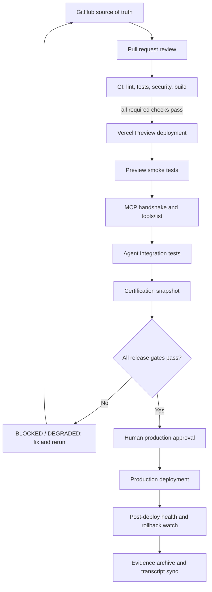

# BnhassinAgent operational roadmap

Status of this document: **proposed operating contract**, not a certification result. No control is considered passed without a fresh, attributable evidence record.

## 1. Release architecture



Production is a protected, separately approved action. CI or Preview success alone never authorizes production.

## 2. Stage contract

| Stage | Dependencies | Inputs | Outputs / evidence | Exit criteria |
|---|---|---|---|---|
| S0 — Inspect & normalize | GitHub access; known repo/branch | repo, base SHA, release intent | source inventory, commit SHA, config inventory | No guessed endpoints, project IDs, or secrets; drift recorded |
| S1 — Pull request | branch protection; reviewers | diff, issue/acceptance criteria | PR URL, changed paths, review decisions | No unresolved blocking review; PR is not from untrusted fork when secrets are needed |
| S2 — CI | GitHub Actions, pinned toolchain | exact commit SHA | workflow/run IDs, job results, test counts, scan results | Required checks all pass on the exact candidate SHA |
| S3 — Preview | Vercel project link and Preview token | candidate SHA, project ID, environment | deployment ID/URL, build logs, commit association | Deployment READY; target is Preview, not Production |
| S4 — Preview smoke tests | reachable Preview URL | URL, test fixture, expected API contract | HTTP/status assertions, route results, timestamps | Core UI and API routes pass; no credentials in output |
| S5 — MCP validation | real MCP endpoint and auth path | endpoint, transport, auth grant, allowed tool list | handshake result, server/protocol version, tools/list summary | Authenticated handshake succeeds and expected tools are present; root HTTP 404 is not enough to infer MCP failure |
| S6 — Agent integration | valid model/provider config; test data | MCP tool registry, session API, fixture | trace/run ID, tool invocation outcomes, structured output | Agent completes deterministic scenario; errors/timeouts bounded |
| S7 — Certification snapshot | all preceding evidence | candidate SHA + deployment ID | immutable JSON snapshot, control statuses, evidence refs | All mandatory controls PASS; no stale/missing evidence |
| S8 — Human release approval | branch protection and production permissions | snapshot, diff, rollback plan | approver identity/time, approval event | Explicit approval for the exact SHA and deployment |
| S9 — Production release | approved release, production credentials | exact artifact/SHA | production deployment ID, URL, release marker | Deployment READY; no implicit promotion from Preview |
| S10 — Post-release health | real health endpoint and telemetry | production URL, release ID | HTTP/API checks, runtime error window, rollback decision | Health checks pass for agreed observation window; rollback path documented |
| S11 — Handoff & sync | evidence storage / transcript sync mechanism | snapshot, deployment details | changelog, local sync status, operator handoff | Evidence discoverable and status synchronized |

## 3. Typed certification model

Control status enum:

- `NOT_TESTED`: not executed.
- `PENDING`: execution started or waiting on a dependency.
- `PASS`: fresh evidence proves the acceptance criteria.
- `WARN`: usable but a non-blocking limitation is recorded.
- `FAIL`: executed and failed.
- `BLOCKED`: cannot execute because a prerequisite is missing.

Overall certification status enum:

- `NOT_READY`
- `CERTIFICATION_IN_PROGRESS`
- `READY_FOR_GO_LIVE`
- `GO_LIVE`
- `DEGRADED`
- `BLOCKED`

A status is not inferred from prose. It is computed from controls and evidence. `GO_LIVE` is only valid after a production deployment has been verified and post-deployment health evidence is current. Before deployment, the highest permissible status is `READY_FOR_GO_LIVE`.

### Required control catalog

| Control ID | Type / gate | Required evidence | PASS condition |
|---|---|---|---|
| `SRC-001` | Source integrity | repo, branch, candidate SHA, PR URL | SHA matches the reviewed PR head |
| `CI-001` | Required checks | workflow run ID, per-job conclusion, run URL | Every required check succeeds for candidate SHA |
| `SEC-001` | Secret scan | scanner name/version, result summary, run URL | No detected secret; false positives dispositioned |
| `TEST-001` | Unit tests | command, test totals, failures, run URL | Tests execute and all pass; missing suite is FAIL |
| `BUILD-001` | Build reproducibility | runtime versions, lockfile/hash, build result | Build succeeds using committed dependency lock |
| `PREVIEW-001` | Preview deployment | Vercel project ID, deployment ID/URL, target, SHA | State READY, target Preview, SHA matches candidate |
| `HTTP-001` | Preview smoke test | URL, path, status, timestamp, response assertion | UI and each declared API route meet contract |
| `MCP-001` | MCP transport | endpoint, transport, protocol/server version, auth method (no secret) | Authenticated handshake and initialization succeed |
| `MCP-002` | MCP tool discovery | expected tool names, observed names, result ref | Required tools discovered; unexpected privileged tools reviewed |
| `AGENT-001` | Agent scenario | scenario ID, run/trace ID, expected vs actual | Deterministic acceptance assertions pass |
| `DATA-001` | Persistence | migration result, write/read/delete test refs | Data persists across requests and isolation tests pass |
| `SEC-002` | Access control | unauthorized/authorized test results, rate-limit test | Unauthorized requests rejected; quotas enforced |
| `DOCS-001` | Documentation alignment | docs commit, deployed branch, deployment status | Docs describe the tested API and intended deploy branch |
| `APPROVAL-001` | Human approval | approver, timestamp, approved SHA, release target | Explicit approval matches the exact candidate SHA |
| `PROD-001` | Production deploy | deployment ID, URL, target, SHA, event URL | Production deployment READY and matches approved SHA |
| `HEALTH-001` | Post-deploy health | endpoint results, runtime error window, observation time | All critical checks pass for the agreed observation window |
| `ROLLBACK-001` | Rollback readiness | prior known-good deployment, rollback runbook/link | Operator can identify and execute a tested rollback |
| `SYNC-001` | Evidence/transcript sync | snapshot ID, destination, sync timestamp | Snapshot stored and sync verified |

## 4. Evidence record contract

Every evidence item should be structured and linked to one control. Store no API keys, access tokens, raw customer data, or sensitive prompt content.

```json
{
  "schema_version": "1.0",
  "evidence_id": "ev_<unique-id>",
  "control_id": "CI-001",
  "status": "PASS",
  "observed_at": "2026-01-01T00:00:00Z",
  "repository": "owner/repository",
  "commit_sha": "<full-sha>",
  "environment": "preview",
  "source": {
    "kind": "github_actions",
    "url": "<run-url>",
    "run_id": "<run-id>"
  },
  "assertions": [
    {
      "name": "required_checks_passed",
      "expected": true,
      "actual": true
    }
  ],
  "summary": "All required checks passed for the candidate commit.",
  "redactions_applied": true
}
```

Evidence is valid only if:
1. It is attributable to a known source and exact candidate SHA/deployment.
2. Its timestamp is within the control's freshness window.
3. It contains enough detail to verify the acceptance criteria.
4. It is not just a manually written status without source output.
5. A failed or missing assertion cannot be converted to PASS by a later summary.

Recommended default freshness: CI and Preview evidence must match the exact release SHA; health evidence should be less than 15 minutes old when evaluating current health; production approval is invalidated by any change to the approved SHA or deployment target.

## 5. Gate computation rules

- Any mandatory control in `FAIL` makes the release `BLOCKED` until fixed and retested.
- Any mandatory control in `BLOCKED` prevents `READY_FOR_GO_LIVE`.
- Missing or stale evidence means `NOT_TESTED` or `PENDING`, never PASS.
- Any mandatory `WARN` requires an explicit documented risk acceptance; otherwise block.
- `READY_FOR_GO_LIVE` requires all pre-production gates PASS, a rollback plan, and human approval readiness.
- `GO_LIVE` requires verified production deployment plus current post-deploy health evidence.
- Production deployment failure or failed critical health check results in `DEGRADED` or `BLOCKED` and triggers rollback evaluation.
- A Vercel `READY` deployment is not equivalent to a successful MCP handshake or a healthy Agent.
- A root URL returning 404 is not proof of MCP failure until the actual transport endpoint and auth requirements are known.

## 6. Current snapshot — verified blockers and unknowns

This is a dated operational snapshot, not a live certification status.

| Item | Observed state | Evidence / action needed |
|---|---|---|
| PR #4 workflow/API fix | Open draft; CI run reported success | Review the diff and Preview workflow behavior; do not merge automatically |
| PR #3 feature registry | Open, separate feature proposal | Review for overlap with certification plan and CI changes |
| Vercel Preview workflow | Code prepared on PR #4; requires `VERCEL_TOKEN` secret to run | Verify token scope and Preview-only target before enabling |
| GCP staging auth | Prior workflow failed because project/region were empty and auth action lacked OIDC provider or credentials | Configure environment-scoped variables/secrets; rerun staging |
| MCP endpoint | Project deployment exists; root returned 404 previously | Identify the actual HTTP/SSE/streamable HTTP endpoint and required auth; run handshake |
| Vercel project mapping | Multiple Vercel projects linked to the MCP repo | Record project ID, root directory, build command, target branch, and purpose for each |
| Mintlify source | Connected to `bnhassin/mintlify-docs`, deploy branch `bnhassin-patch-1`; no source checks configured | Confirm intended branch and add source checks |
| Persistent database | PostgreSQL/schema/migration/backup path not evidenced in the inspected main tree | Decide database owner and implement migrations, isolation, backup/restore tests |
| Health endpoint | A real endpoint/contract is not yet established in this roadmap | Define endpoint and safe assertions before enabling HEALTH-001 |
| Certification tools | Typed controls are specified here; tool execution must be implemented and verified | Implement `skills/certification/` and real status/run/check/evidence/health/sync tools; do not stub PASS |

## 7. Suggested implementation sequence

### P0 — unblock trustworthy Preview
1. Review PR #4 and verify its CI results.
2. Confirm Vercel project mapping and Preview-only credentials.
3. Run the Preview workflow and test UI plus API routes.
4. Repair GCP staging OIDC configuration independently.

### P1 — make release gates real
1. Resolve PR #3 versus PR #4 overlap; keep a single required CI definition.
2. Add tests for session API, feature registry, API method/error paths, and auth/rate limits.
3. Add a dependency lock and reproducible build.
4. Identify MCP endpoint/transport and test authenticated handshake plus required tools.
5. Define the real health endpoint and production rollback runbook.

### P1 — implement certification engine
1. Add typed enums/models for controls, evidence, snapshots, and status transitions.
2. Implement read-only `status`, explicit `run`, individual `check`, and append-only `evidence_record`.
3. Add freshness checks, commit/deployment binding, redaction, and deterministic gate computation.
4. Add tests proving missing evidence cannot pass and production cannot be marked GO_LIVE from Preview evidence.
5. Add evidence export and transcript sync only after a concrete destination is configured.

### P2 — controlled production
1. Require reviewed PR, all mandatory checks, Preview evidence, MCP/Agent integration evidence, and human approval.
2. Deploy the exact approved SHA to production through the intended Vercel/GitHub release path.
3. Verify deployment ID, health, runtime errors, and rollback readiness.
4. Publish the documentation and certification snapshot after release evidence is complete.

## 8. Operator checklist

- [ ] Candidate SHA and PR reviewed
- [ ] Required CI checks PASS on the exact SHA
- [ ] Secret scan PASS
- [ ] Unit/integration tests PASS
- [ ] Preview deployment READY and SHA-matched
- [ ] Preview API smoke tests PASS
- [ ] MCP handshake and required tools verified
- [ ] Agent integration scenario PASS
- [ ] Persistence, isolation, and access-control checks PASS
- [ ] Documentation branch and content verified
- [ ] Rollback target and runbook verified
- [ ] Human production approval recorded for exact SHA
- [ ] Production deployment verified
- [ ] Post-deployment health evidence fresh and PASS
- [ ] Evidence snapshot archived and sync verified

Until the production and post-deployment checks above have fresh, valid evidence, do not report `GO_LIVE`.
